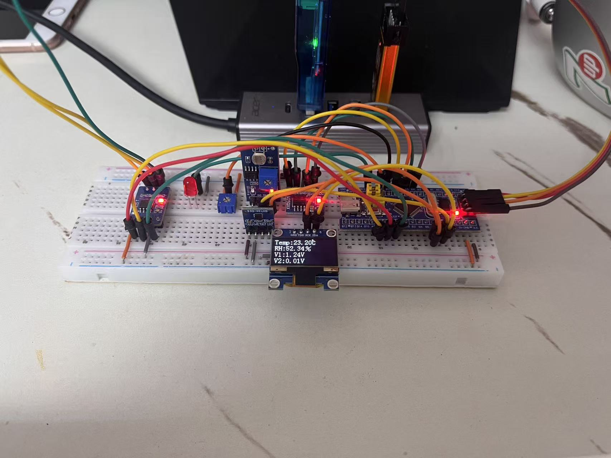
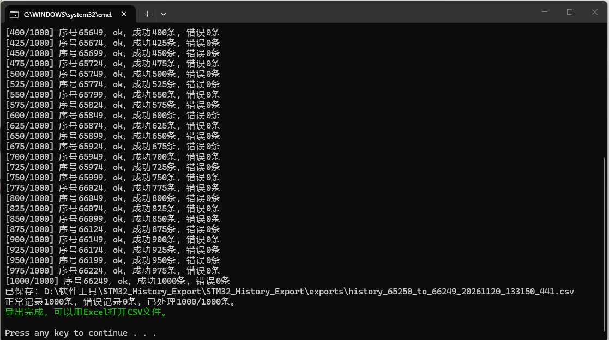

# 演示资料

本目录收录两段演示视频、实物照片、历史日志导出截图及作者提供的操作说明。

## 演示视频

| 内容 | 视频时长 | 文件大小 | 查看 / 下载 |
| --- | --- | --- | --- |
| 主站修改报警温度与回差，观察报警解除行为 | 约 1 分 10 秒 | 8.93 MB | [报警温度与回差演示](videos/alarm-hysteresis.mp4) |
| 1000 条历史日志读取与 CSV 导出演示片段 | 约 17 秒 | 2.06 MB | [历史日志导出演示](videos/history-export-1000.mp4) |

视频保持原始内容，仅重命名以便识别。文件为 HEVC（H.265）编码的 MP4；若网页无法预览，可下载后使用支持该编码的播放器打开。

表中时长为视频文件时长，**17 秒不代表导出 1000 条记录的实际总耗时**。当次完整导出耗时及重试统计未随 CSV 记录；视频内容说明由作者提供。

## 实物照片

照片可见开发板、OLED、传感器与模拟输入模块的连接状态。

引脚和连接要求见 [硬件说明](../hardware.md)。

## 1000 条历史日志导出

终端截图显示请求范围的导出结果：正常记录 1000 条，错误记录 0 条，已处理 1000/1000。

- [原始 CSV](../test-records/history-export/history_65250_to_66249_20261120_133150_441.csv)
- [记录数量、序号与时间间隔核对](../test-records/history-export/README.md)
- [导出工具与运行方法](../../tools/history-export/README.md)

CSV 序号连续，全部状态为 ok。工具允许对通信失败重试，该汇总不表示全部请求都首次成功；日志时间差中有一处 10 秒，详见核对记录。

## 报警温度与回差演示

作者描述的演示过程：报警温度设为 24.00 ℃，回差 0.25 ℃，升温触发报警后，降到 23.75 ℃ 时报警解除；再将回差改为 0.50 ℃，再次触发报警后，降到 23.75 ℃ 时仍保持报警。

[报警回差演示摘要](../test-records/alarm-hysteresis.md) 单独保留了上述操作描述；参数持久化、重启恢复等结果应按各自测试条件和证据填写。
